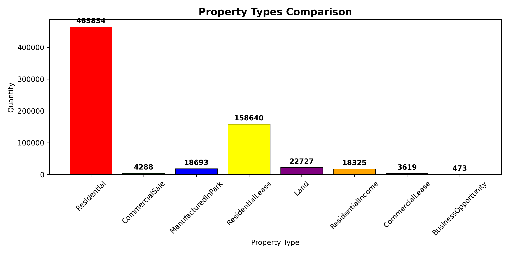
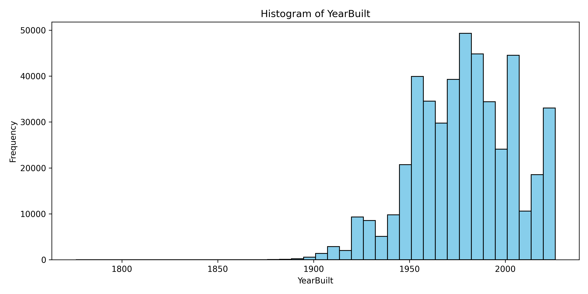

# IDX Exchange Data Analyst Internship Project

I built this pipeline during my data analyst internship at IDX Exchange. It works with California MLS (CRMLS) data from January 2024 to June 2026. That comes to 30 monthly files each for listings and closed sales, about 1.6 million rows in total. The scripts combine the monthly files, clean them, add mortgage rate and school district data, and produce a final dataset ready for analysis.

Tableau Dashboards: https://public.tableau.com/app/profile/harrisonwwilliams/vizzes
Market Intelligence Report: https://1drv.ms/w/c/a88d152ab49a4ee2/IQCU7SSb9BxYSr1wvKUd9G4gAfEOFF9bR1jstZv8OcBiF0s?e=9qGtwU

## What it does

1. **Combines the monthly files.** The scripts merge all the monthly CSVs into one dataset for listings and one for sales, then keep only residential properties. After that filter there are about 578K listing rows and 464K sold rows.
2. **Adds mortgage rates.** It pulls the 30-year fixed mortgage rate from FRED (MORTGAGE30US), averages it by month, and matches it to each record by close date (sales) or listing date (listings).
3. **Cleans the data.**
   - Drops mostly empty rows and converts dates and numbers to the right types.
   - Removes agent names and emails.
   - Fills missing values: "Unknown" for categories, the median for numbers.
   - Adds flags for bad values instead of deleting them. Examples are negative days on market, a contract dated after closing, and coordinates outside California.
4. **Engineers features.** It adds price ratio (close price / original list price), price per square foot, days from listing to contract, days from contract to close, and close year and month. It also prints a summary by county.
5. **Adds school districts.** A spatial join with GeoPandas assigns each property to its California unified school district.
6. **Removes outliers.** It uses the 1.5×IQR rule on close price, living area and days on market. A flagged version with every row is saved too, so nothing is lost.

I also did exploratory analysis on the raw data. That included property type breakdowns, distributions of the main numeric fields, the share of homes sold above vs. below list price, median prices by county, and a check for columns that are mostly null.

## Some of the EDA

Most closed sales are residential, which is why I focused the project on residential properties:



Most homes that sold were built between the 1950s and 2000s, with a smaller group of newer construction from the last few years:



The rest of the histograms and box plots are in `reports/numeric_plots/`.

## Project structure

```
src/
  listing_data_script/    aggregation, cleaning, feature engineering, final dataset (listings)
  sold_data_script/       same steps for sold data
  merge_mortgage_data.py  adds FRED mortgage rates
  geo_data.py             school district spatial join
notebooks/
  EDA_numbers/            summary stats, null report, outlier counts, numeric plots
  EDA_plots/              property type bar charts
  EDA.ipynb               scratch notebook
reports/                  saved charts
data/                     raw CRMLS files (not included)
```

## Running it

The MLS data is licensed, so it isn't in this repo. To run the pipeline, you'd need the monthly `CRMLSListing{YYYYMM}.csv` and `CRMLSSold{YYYYMM}.csv` files in `data/`, along with the school district GeoJSON.

Install the packages:

```
pip install pandas numpy matplotlib seaborn geopandas shapely
```

Run the scripts from the repo root in this order:

```
python src/listing_data_script/listing_data_aggregation.py
python src/sold_data_script/sold_data_aggregation.py
python src/merge_mortgage_data.py
python src/listing_data_script/listing_data_cleaning.py
python src/sold_data_script/sold_data_cleaning.py
python src/listing_data_script/listing_feature_engineering.py
python src/sold_data_script/sold_feature_engineering.py
python src/geo_data.py
python src/listing_data_script/listing_final_dataset.py
python src/sold_data_script/sold_final_dataset.py
```

The final output is `filtered_datasets/final_listing_dataset.csv` and `filtered_datasets/final_sold_dataset.csv`.

## Tools

Python, pandas, NumPy, GeoPandas, Shapely, Matplotlib, seaborn, Jupyter

## What I'd improve

- Fill missing values by county instead of using one median for the whole state.
- Include elementary and high school districts, not only unified ones.
- Look more closely at how prices and days on market change as mortgage rates move.

## Data sources

- Listing and sales data: CRMLS, through IDX Exchange
- Mortgage rates: Freddie Mac, via FRED (Federal Reserve Bank of St. Louis)
- School district boundaries: California Department of Education