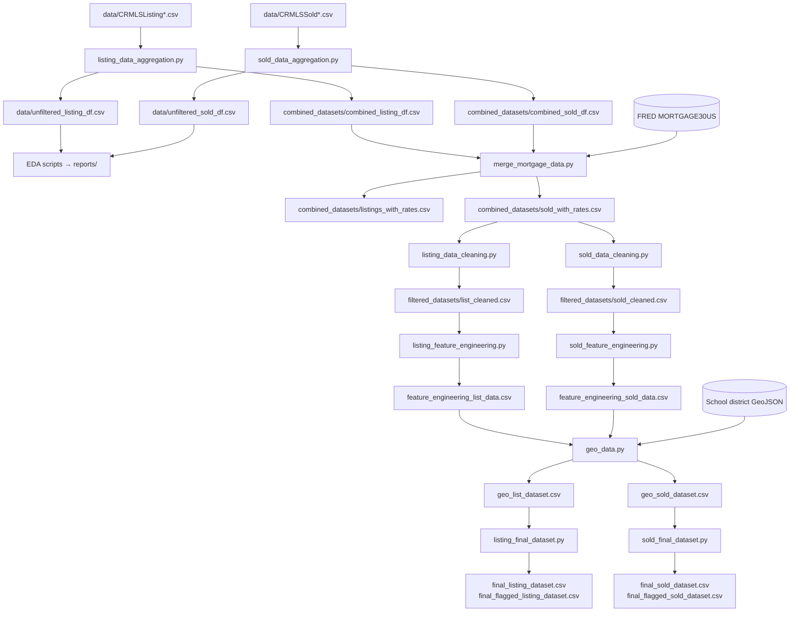

# Pipeline Reference

This document explains each stage of the pipeline: what it reads, what it does, and what it writes. Run all scripts from the repository root.

← [Back to README](../README.md)

---

## Data Lineage

> ⚠️ The diagram shows the scripts as they are currently written. `listing_data_cleaning.py` reads `combined_datasets/sold_with_rates.csv`, not `listings_with_rates.csv`. See [Known Issues](#known-issues).

---

## Stage 1: Aggregation

**Scripts:** `src/listing_data_script/listing_data_aggregation.py`, `src/sold_data_script/sold_data_aggregation.py`

| | |
|---|---|
| **Input** | `data/CRMLSListing*.csv` / `data/CRMLSSold*.csv` (one file per month) |
| **Output** | `data/unfiltered_*_df.csv` (all property types, used for EDA) `combined_datasets/combined_*_df.csv` (residential only) |

**Logic**
1. Finds the monthly files with a glob pattern and reads each one. If a file fails to decode as UTF-8, the script falls back to `cp1252`.
2. Concatenates the monthly frames into a single DataFrame.
3. *Sold only:* drops the helper columns `latfilled` and `lonfilled`.
4. Saves the unfiltered result, then filters to `PropertyType == 'Residential'`.

**Row counts (latest run)**

| Dataset | Avg rows / month | Combined | Residential |
|---|---|---|---|
| Listing | ~31,365 | 909,571 | 578,257 |
| Sold | ~21,581 | 690,599 | 463,834 |

---

## Stage 2: Mortgage-Rate Enrichment

**Script:** `src/merge_mortgage_data.py`

| | |
|---|---|
| **Input** | `combined_datasets/combined_*_df.csv`, plus the [FRED MORTGAGE30US](https://fred.stlouisfed.org/series/MORTGAGE30US) CSV fetched live |
| **Output** | `combined_datasets/sold_with_rates.csv`, `combined_datasets/listings_with_rates.csv` |

**Logic**
1. Downloads weekly 30-year fixed mortgage rates and averages them by calendar month.
2. Builds a `year_month` join key for each dataset:
   - **Sold:** from `CloseDate`
   - **Listing:** from `ListingContractDate`
3. Left-joins the monthly rate as `rate_30yr_fixed`.
4. Prints the count of rows without a rate to confirm the merge worked.

---

## Stage 3: Cleaning & Validation

**Scripts:** `src/listing_data_script/listing_data_cleaning.py`, `src/sold_data_script/sold_data_cleaning.py`

| | |
|---|---|
| **Input** | `combined_datasets/sold_with_rates.csv` (see [Known Issues](#known-issues)) |
| **Output** | `filtered_datasets/list_cleaned.csv`, `filtered_datasets/sold_cleaned.csv` |

**Logic**
1. **Sparse-row removal:** keeps only rows with at least 10% of columns populated.
2. **Type coercion:** converts four date fields to `datetime` and 12 numeric fields to numbers, with `errors='coerce'`.
3. **PII removal:** drops agent name, email and MLS ID columns.
4. **Imputation:**
   - `City`, `CountyOrParish` and `StateOrProvince` nulls become `"Unknown"`.
   - Numeric nulls become the column median.
5. **Validation flags:** adds 12 boolean columns. See the [data dictionary](data_dictionary.md#data-quality-flags).
6. Prints a summary report with row counts, dtypes, timeline-flag counts and geographic-flag counts.

---

## Stage 4: Feature Engineering

**Scripts:** `src/listing_data_script/listing_feature_engineering.py`, `src/sold_data_script/sold_feature_engineering.py`

| | |
|---|---|
| **Input** | `filtered_datasets/*_cleaned.csv` |
| **Output** | `filtered_datasets/feature_engineering_*_data.csv` |

**Logic**
1. Converts date columns back to datetime, because CSV files don't store dtypes.
2. Adds price, time-on-market and calendar features. See the [data dictionary](data_dictionary.md#engineered-features).
3. Prints a sample table and a summary by `CountyOrParish` with count, mean and median close price, mean price ratio, mean price per sq ft, mean DOM and mean interval days.

---

## Stage 5: School-District Spatial Join

**Script:** `src/geo_data.py`

| | |
|---|---|
| **Input** | `filtered_datasets/feature_engineering_*_data.csv`, `data/DistrictAreas2526_*.geojson` |
| **Output** | `filtered_datasets/geo_list_dataset.csv`, `filtered_datasets/geo_sold_dataset.csv` |

**Logic**
1. Loads the 2025–26 California school-district boundaries and keeps `DistrictType == "Unified"`.
2. Reprojects the polygons from Web Mercator (EPSG:3857) to WGS84 (EPSG:4326).
3. Builds `Point(Longitude, Latitude)` geometry for every property.
4. Runs `gpd.sjoin(..., how="left", predicate="within")` and writes the matched `DistrictName` as `UnifiedSchoolDistrict`.

---

## Stage 6: Outlier Detection & Final Datasets

**Scripts:** `src/listing_data_script/listing_final_dataset.py`, `src/sold_data_script/sold_final_dataset.py`

| | |
|---|---|
| **Input** | `filtered_datasets/geo_*_dataset.csv` |
| **Output** | `filtered_datasets/final_flagged_*_dataset.csv` (all rows, with flags) `filtered_datasets/final_*_dataset.csv` (outliers removed) |

**Logic**
1. Computes Tukey fences, `[Q1 − 1.5·IQR, Q3 + 1.5·IQR]`, for `ClosePrice`, `LivingArea` and `DaysOnMarket`.
2. Adds a `<Field>_outliers_flag` column for each field and saves the flagged dataset.
3. Removes any row flagged on **any** of the three fields.
4. Prints dataset size and medians before and after filtering.

---

## Exploratory Analysis Scripts

| Script | Purpose |
|---|---|
| `notebooks/EDA_numbers/*_data_EDA.py` | Property-type shares, close-price median and mean, % above or below list, date-consistency check, median price by county, null report (flags >90% missing), percentile summary, IQR outlier counts. Writes 18 plots per dataset to `reports/numeric_plots/` |
| `notebooks/EDA_plots/plot_*_data_EDA.py` | Bar charts of all property types and of residential vs. other, written to `reports/` |
| `notebooks/EDA.ipynb` | Scratch notebook for inspecting the cleaned dataset interactively |

---

## Known Issues

These are documented here for transparency. The scripts have not been changed.

- **Listing cleaning input:** `listing_data_cleaning.py` reads `combined_datasets/sold_with_rates.csv`. Because of this, the downstream "listing" outputs are currently built from sold records. The intended input is probably `combined_datasets/listings_with_rates.csv`.
- **Coordinate summary label:** in both cleaning scripts, the printed "Implausible coordinates" count uses `missing_coords_flag` instead of `implausible_coords_flag`. Only the console summary is affected. The flag column itself is computed correctly.
- **Notebook path:** `notebooks/EDA.ipynb` loads its data from an absolute Windows path. To run it on another machine, change the path to a relative one.
